# 作业1：TuGraph 图数据库实验

专业综合实践课程作业。项目完成 TuGraph 4.5.1 部署、医疗知识图谱建模、CSV 数据导入、增删改查和聚合查询。

[实验报告正文 PDF](report/作业1.pdf) · [LaTeX 主文件](latex/main.tex) · [Cypher 操作代码](cypher/demo.cypher) · [图模型及导入配置](data/import.json)

## 1. 整体设计

采用疾病、症状、科室、药品四类实体建立属性图。节点用 name 作为主键，关系根据起点和终点主键关联节点。

处理流程：CSV 数据 → JSON 图模型与字段映射 → lgraph_import 导入 → TuGraph 存储 → Cypher 查询 → Browser 展示。

| 节点类型 | 主要属性 | 数量 |
|---|---|---:|
| Disease | name、category | 4 |
| Symptom | name、severity | 7 |
| Department | name | 3 |
| Drug | name、kind | 3 |

| 关系类型 | 起点 | 终点 | 数量 |
|---|---|---|---:|
| HAS_SYMPTOM | Disease | Symptom | 12 |
| BELONGS_TO | Disease | Department | 4 |
| TREATS | Disease | Drug | 4 |

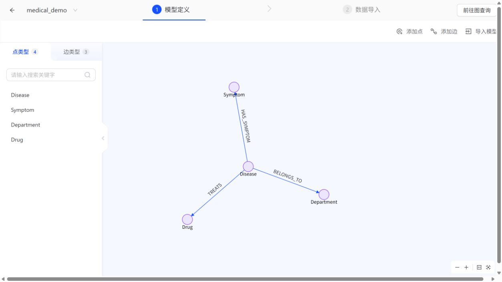

## 2. 安装与启动

由于本地设备性能充足，本实验采用 Docker 在本地部署 TuGraph。环境为 Windows、Docker Desktop、Linux x86_64 容器。TuGraph 版本 4.5.1，运行图项目名为 medical_demo。

```powershell
git clone https://github.com/MuonChaser/tugraph-homework-1.git
cd tugraph-homework-1
.\setup.ps1
```

setup.ps1 下载官方 RPM 安装包、校验 SHA256、通过 Dockerfile 构建运行镜像，在空目录执行首次导入，然后启动服务。

| 服务 | 本机地址 |
|---|---|
| Browser | http://127.0.0.1:17070 |
| Bolt | bolt://127.0.0.1:17687 |
| RPC | 127.0.0.1:19090 |

登录账号 admin，默认密码 73@TuGraph。Browser 登录时填写 Bolt 地址 127.0.0.1:17687。

```powershell
docker ps --filter name=tugraph-assignment
docker logs --tail 30 tugraph-assignment
docker stop tugraph-assignment
docker start tugraph-assignment
```

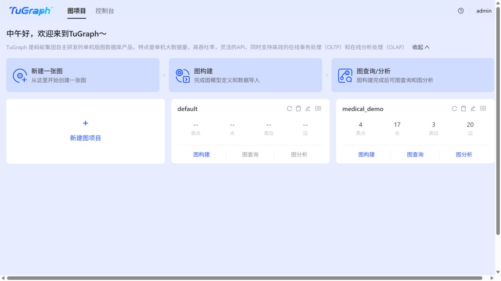

## 3. 数据导入

data 目录包含四份节点 CSV 和三份关系 CSV，data/import.json 定义节点、边、字段类型、主键及文件列映射。header=1 表示跳过 CSV 表头。

```json
{
  "path": "/workspace/data/disease_symptom.csv",
  "header": 1,
  "format": "CSV",
  "label": "HAS_SYMPTOM",
  "SRC_ID": "Disease",
  "DST_ID": "Symptom",
  "columns": ["SRC_ID", "DST_ID"]
}
```

首次运行时使用原生离线导入工具：

```text
lgraph_import --config_file /workspace/data/import.json \
  --dir /workspace/runtime/db --graph medical_demo
```

导入后的节点数为 17，关系数为 20。原始导入日志见 evidence/import.log。

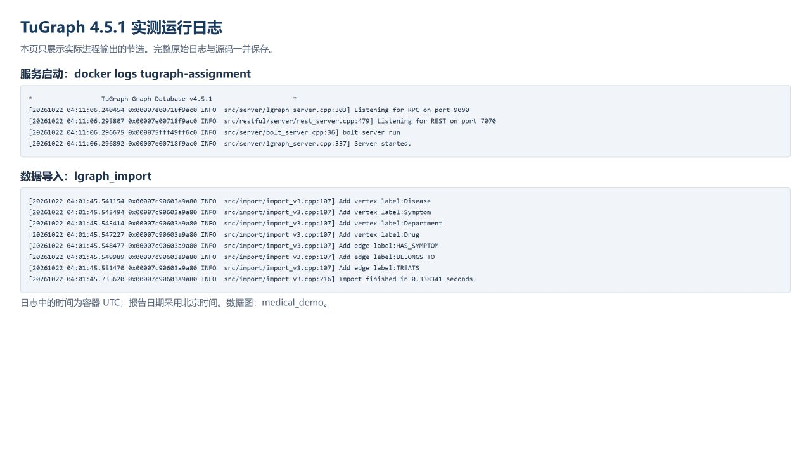
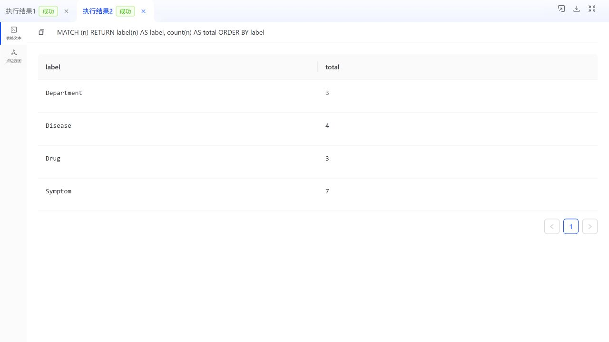

## 4. 增删改查

在 Browser 选中 medical_demo，逐条执行 cypher/demo.cypher。

```cypher
// 增
CREATE (x:Symptom {name:'临时症状-CRUD', severity:'测试'})
RETURN x.name AS name, x.severity AS severity;

// 查
MATCH (x:Symptom {name:'临时症状-CRUD'})
RETURN x.name AS name, x.severity AS severity;

// 改
MATCH (x:Symptom {name:'临时症状-CRUD'})
SET x.severity = '已修改'
RETURN x.name AS name, x.severity AS severity;

// 删
MATCH (x:Symptom {name:'临时症状-CRUD'}) DELETE x;

// 删除后复查
MATCH (x:Symptom {name:'临时症状-CRUD'})
RETURN count(x) AS remaining;
```

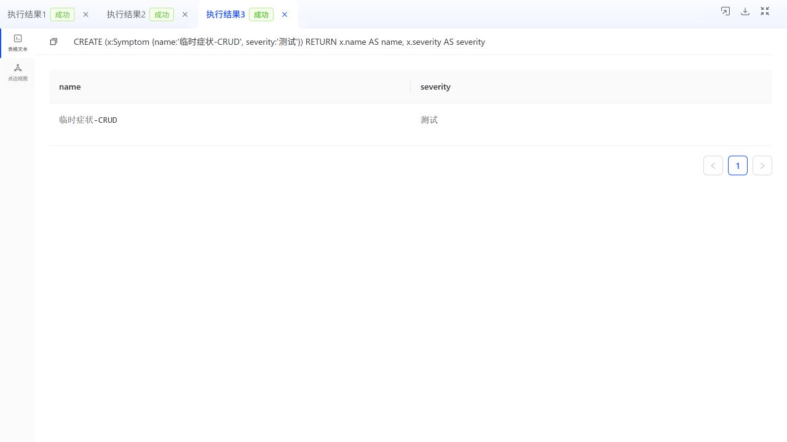
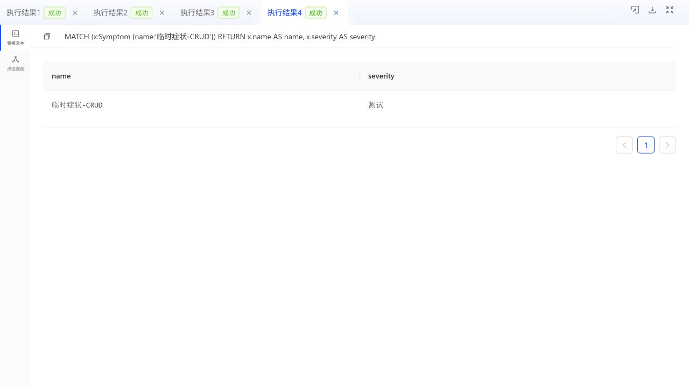
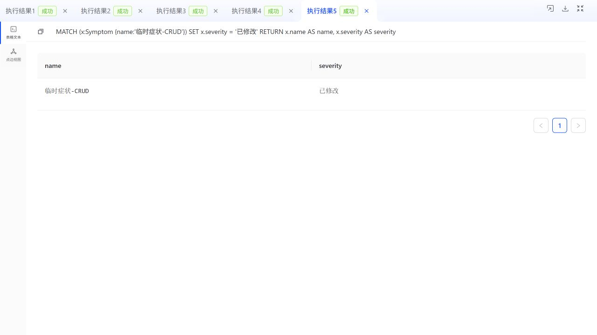
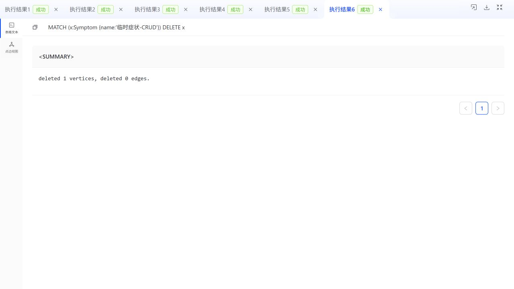
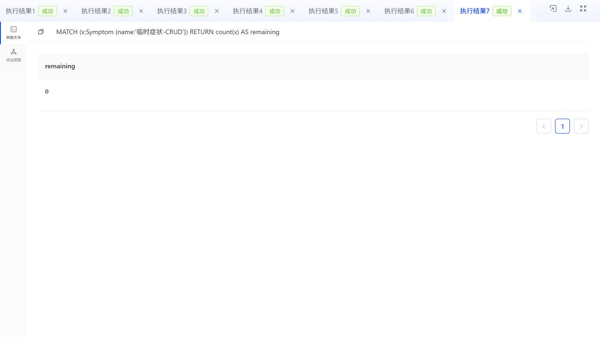

## 5. 聚合查询

统计各疾病关联的不同症状数量，按数量降序排列：

```cypher
MATCH (d:Disease)-[:HAS_SYMPTOM]->(s:Symptom)
RETURN d.name AS disease, count(DISTINCT s) AS symptom_count
ORDER BY symptom_count DESC;
```

| 疾病 | 症状数 |
|---|---:|
| 普通感冒 | 4 |
| 过敏性鼻炎 | 3 |
| 流行性感冒 | 3 |
| 急性咽炎 | 2 |

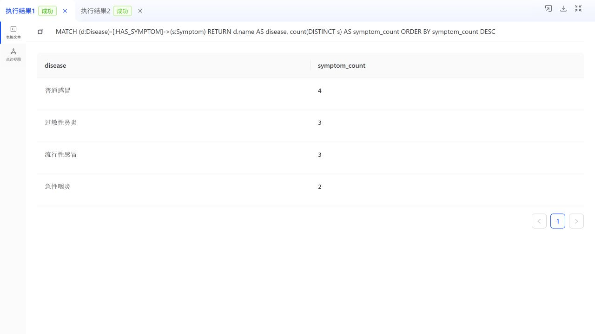
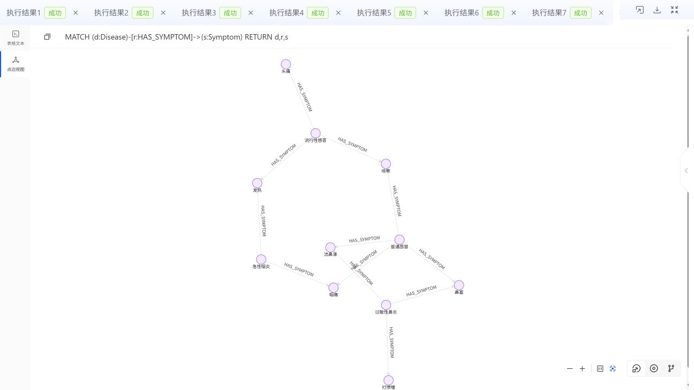

## 6. 结果核对

```powershell
python -m pip install -r requirements.txt
python scripts/verify_runtime.py
```

脚本通过 Bolt 连接数据库，核对节点、关系、聚合结果及临时节点清理情况。结果见 evidence/results.json。

## 7. LaTeX 排版

latex/main.tex 为报告正文，latex/cover.tex 为 CUFE 课程报告模板封面，latex/student-info.tex 为封面字段。

```powershell
cd latex
.\compile.ps1
```

使用 Windows XeLaTeX 编译。中文字体为宋体、黑体、楷体与仿宋，PDF 已嵌入字体及 Unicode 映射。封面模板说明保存在 latex/template/NOTICE.md。

## 文件结构

```text
Dockerfile                 容器运行环境
setup.ps1                  下载、构建、导入与启动
config/lgraph.json         TuGraph 配置
data/                      7份CSV及导入映射
cypher/demo.cypher         查询和增删改查代码
scripts/verify_runtime.py  数据核对脚本
evidence/                  运行日志和核对结果
screenshots/               11张运行截图
latex/                     报告LaTeX源码及插图
report/作业1.pdf           实验报告正文
```
